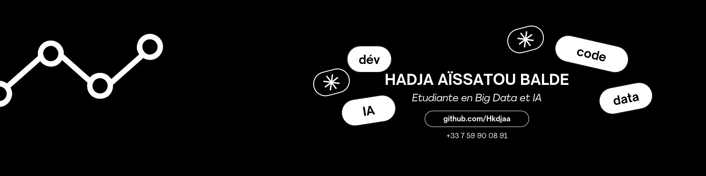
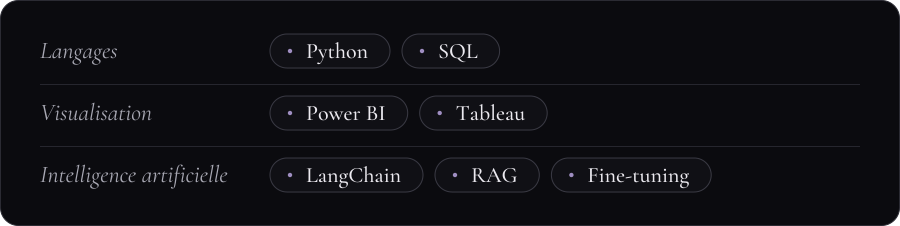

   
Je travaille sur les données et sur le langage, avec une idée fixe :  une IA qu'on comprend est une IA dont on peut vraiment se servir.
 <h3>En ce moment</h3>
Master 2 Big Data & IA à Paris  Je construis des projets autour du RAG et du fine-tuning  Je cherche une alternance en data et IA
 <h3>Le grimoire</h3>   <h3>Chroniques</h3>
Assistant CV   Un assistant RAG qui permet de récupérer uniquement les données étant sur le CV.
Nom du projet  Un dashboard explorant la place des femmes dans les métiers du numériques.
 <h3>Me contacter</h3>
www.linkedin.com/in/hadja-aissatou-balde  ·  hadja.balde@outlook.com

